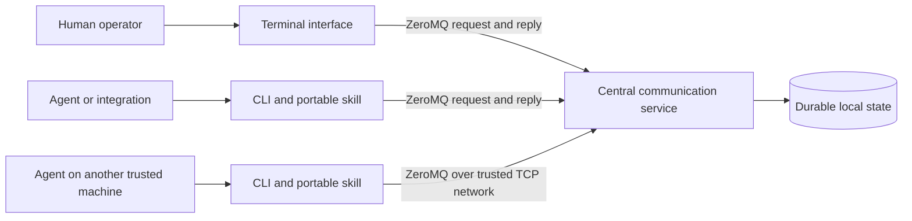

# System architecture

**Status:** Draft architectural description for review, 2026-11-09. The stakeholder approved the initial requirements and central-service direction; this document does not approve the unresolved details or assert that V1 is implemented. The [requirements](requirements.md) define obligations, [decisions](decisions.md) records choices and open questions, and [verification](verification.md) defines the planned evidence. If this description and a requirement conflict, resolve the discrepancy rather than treating this document as a change to the requirement.

## Purpose and scope

Aviary provides durable messaging and a human attention interface for agents working across processes and, on a trusted local network, machines. Agents manage their own execution; the service manages communications; the operator makes decisions. The system is independent of any model or orchestration framework. A CLI and portable skill are the intended agent integration; MCP and a particular agent hierarchy are not required.

V1 is a single-user deployment centered on one service. It includes operator decisions and instructions, targeted agent messages and request/reply through channels, completion notices, and recoverable history. Project management, agent lifecycle control, public deployment, application authentication and multi-user isolation are outside V1. The first-slice prototype implements only a narrow decision path; see [prototype status](#first-slice-and-evidence).

## Context and boundaries

The diagram shows logical responsibilities, not a commitment to separate executables for every box. The service is the shared point for routing, state and recovery. The terminal interface is an independent client: closing it must not stop the service or agents. The CLI provides a documented machine-readable boundary for agents and scripts. The portable skill describes how to use that boundary; it is not an orchestrator. Local state is owned by the service, and clients use the service interface rather than treating the storage format as their contract.

One central service simplifies shared history, correlation and deduplication but is an availability and trust dependency. Agents cannot submit to it while it is unreachable. No service replication or multi-site availability is promised. The service handles SIGINT and SIGTERM by stopping its receive loop after the current operation; queued replies may be lost and remain unknown outcomes. Supervision, the supported POSIX platforms and distribution method remain open.

## Responsibilities and interfaces

| Element | Intended responsibility | Key interfaces and constraints |
|---|---|---|
| Communication service | Accept communications, route addressed traffic, maintain request and response state, apply retry and single-decision rules, and expose retrieval and history. | A documented client interface; the service owns persistence and acknowledges acceptance only after the durability boundary. |
| Durable state | Retain accepted messages, decisions, relationships and retry identities through the agreed crash/restart boundary. | V1 default is indefinite retention without automatic deletion; retry identities last as long as their associated records. Storage loss and backup recovery are outside the agreed guarantee. |
| Terminal interface | Consolidate actionable requests; show explanations, context, priority and completion notices; support decisions, deferral and outgoing instructions. | Keyboard operated; recommended answers are first and preselected, but confirmation is explicit. Interface closure does not stop the service. |
| Agent CLI and skill | Provide a portable, documented way to submit, retrieve and wait for communications using structured results. | Caller retains the identifiers needed for retry and later retrieval. No mandatory MCP, runtime or model. |
| Agent and operator | Supply request content, context and routing labels; agents act on responses, and the operator controls importance and makes decisions. | Agent suggestions do not make decisions for the operator. Names are routing labels, not authenticated identities. |

The selected communication transport is ZeroMQ over TCP. The precise application schema, versioning, message limits, delivery acknowledgments, client compatibility and service lifecycle require further design. The current prototype protocol is described in the [README](../README.md); it is not a stable V1 contract.

## ZeroMQ communication design

The target architecture uses ZeroMQ between each CLI or terminal client and the central service. Use a service-side ROUTER socket and client-side DEALER sockets for request/reply, allowing multiple clients and multiple outstanding operations without coupling service processing to strict alternating request/reply. This socket arrangement is the initial design to validate during implementation; the current implementation and limits are documented below; full compatibility remains under verification. A client request carries an application correlation identifier; the service replies to the originating connection with that identifier and an explicit success or error. A ZeroMQ routing identity is transient transport metadata, not an authenticated participant or a durable submission identity.

The operator has proposed asynchronous change notifications without periodic polling for both the operator UI and agents. Evaluate whether ZeroMQ can provide bounded subscriptions and reconnection while keeping notification delivery separate from durable acceptance. A client must reconcile missed notifications from durable state after reconnect; notifications are hints, not records. The service now accepts bounded change subscriptions on the request/reply transport. Clients reconcile durable state on connection and after change hints; hints can coalesce, and reconnecting clients reread state. Candidate alternatives, event cursor/retention semantics, coalescing, queue bounds and backpressure belong in transport evaluation, not assumed requirements on ZeroMQ.

Use the operator-selected interface as the ZeroMQ TCP bind endpoint, with IPv4 loopback as the default. Clients connect to that endpoint; they do not need a separate ZeroMQ broker. Continue to expose a documented CLI with machine-readable output so integrations need not speak ZeroMQ directly. Version the application protocol independently of the transport; define framing, size limits, timeouts and compatibility before declaring it stable. Switching transports breaks direct compatibility with the existing raw-TCP prototype; coordinated client and service updates are required. The persisted database and the CLI's documented operations should remain compatible unless a migration is explicitly specified and tested.

ZeroMQ provides asynchronous messaging, routing and reconnection mechanisms, not Aviary's durable acceptance or delivery guarantees. The service must persist before returning an application-level acceptance response. A successful ZeroMQ send or queue insertion is not proof of service acceptance. On a timeout or disconnect, a caller must treat the outcome as unknown and retry submissions using the same stable identity; the service returns the original identity for identical content and rejects conflicts. Queue limits, backpressure, unavailable peers and shutdown behavior require explicit bounded policies and tests; a transport reconnect alone does not establish delivery. Keep database-backed retrieval as the recovery path. If notifications are introduced, use them only as hints and reconcile from durable state: subscribers can miss messages or disconnect. See the [ZeroMQ socket API](https://zeromq.org/socket-api/) and [reliability guide](https://zguide.zeromq.org/docs/chapter4/).

## Communication and state

The planned operator interface presents an overview of decisions, messages and completions, searchable retained communications, selected-item previews and clear view and selection context. It distinguishes action outcomes and preserves drafts and reading position through temporary navigation and polling interruptions. These are target behaviors, not claims about the current prototype. Search scope, overview aggregation and pagination, responsive layout, reconciliation and action-specific confirmation remain to be designed. A preview can use a different layout on narrow panes.

The planned terminal uses a documented standardized color system that respects the terminal scheme; color is enabled by default where supported. It must also work with basic-color or monochrome supported terminal configurations, without relying on 256-color support or color alone to distinguish actionable state. The color mechanism, capability handling and minimum terminal controls remain design and verification work.

The planned terminal offers keyboard-accessible on-demand help, with concise contextual hints allowed in normal views; exact trigger and presentation remain to be designed.

The planned default operator composer generates a stable identity for each new instruction and sends it to the `all` channel as a group, so the operator enters only text and confirms the send. Group delivery uses the existing recipient snapshot and excludes the sender; a First Mate can monitor `all` through its participant inbox but is not required. How `all` and its immutable membership are provisioned remains open; no automatic agent enrollment or routing to a running session is implied. The current manual-field composer remains implemented until this target is delivered.

The V1 domain distinguishes participants, channels, addressed communications, decision requests, responses and activity references. A channel supports one or more senders and recipients; messages can target an individual or group. An activity reference relates exchanges without establishing a managed project hierarchy. A request has a correlated response; the V1 agent-to-agent scope is a targeted request and one response. Membership administration, recipient selection, group response races and the timing of membership evaluation remain open. Routing a message only to matching labels is functional delivery behavior, not authorization against a process that can access the service.

A decision starts pending. A recommendation is presentation guidance: it becomes an answer only after explicit operator confirmation. A pending request may be deferred and later retrieved; deferral is not a response. On acceptance of an answer, the service records one decision and makes its structured representation retrievable by the requester. A second decision must be rejected, including under concurrent attempts. The exact response retry and concurrency contract needs design and verification; no cancellation or rollback of an action already taken is implied.

The operator queue is a view of actionable work, ordered by importance with operator override. The initial decision queue uses importance 0–5, default 0, operator overrides, submission-order ties and a separate durable deferred view; senders explicitly distinguish decisions, completion notices and ordinary messages; the quality of that classification remains to be validated with operators. The queue is not the authoritative durable store. Completion notices carry the work and result supplied by the agent. History associates related messages, decisions and outcomes; ordering and the detailed relationship model remain open.

## Principal flows

1. **Submit and decide.** An agent supplies a stable submission identity, question, work context and any suggested answers or recommendation. The service validates and durably records an accepted request before acknowledging it. The terminal retrieves pending work, presents the recommendation first when present, and sends an answer only upon explicit confirmation. The service records one decision; the requester waits for or retrieves the correlated structured answer. Custom answers and requests with no suggestions are V1 requirements, not first-slice capabilities.
2. **Retry and recover.** If the acknowledgement is lost, the caller may retry with the same deployment-scoped submission identity and content. The service returns the existing request identity for an identical retry and rejects different content under the same identity. Following an acknowledged commit, a service or OS crash and restart with intact storage must preserve the accepted record under the agreed storage assumptions. A requester retaining its request identifier can retrieve a response after its own restart. Recovery from a lost storage device is not included.
3. **Route and reconnect.** A sender addresses a communication through a channel to an agent or group. The service records an accepted communication and makes it retrievable according to the eventual routing and delivery policy. An agent that disconnects can retrieve relevant communications accepted for it during the interruption after reconnecting. This does not mean an unreachable service accepted a submission, and the acknowledgment and membership semantics still need definition.
4. **Operate independently.** The local terminal entry point starts the service when absent or reuses a service reporting the same protocol and canonical database path. The service continues when the interface closes. Concurrent starts compete for the loopback listener before opening the database; an explicit positional endpoint never starts a local service. The service also takes an exclusive advisory lock on the database file to reject another Aviary service using the same inode. The lock does not coordinate non-Aviary writers. The identity check is operational, not authentication; see the startup decision and verification for constraints.

## Deployment, trust and failure boundaries

By default the listener binds to localhost. An operator can explicitly select a network interface for agents on a trusted local cluster. V1 has no application authentication or authorization: **any process able to reach the listener is trusted**, including local processes. It can impersonate routing labels or access work through the available interface. The intended V1 ZeroMQ deployment does not add application authentication or transport encryption; the current first-slice protocol is likewise unencrypted. Do not expose this listener to an untrusted network. Future authentication, per-communication authorization and multi-user isolation require a separate security design and threat model; they are not properties of channel membership.

Accepted means positively acknowledged after the durable commit. The approved failure boundary covers service or OS crash and restart with the storage device intact, subject to a functioning storage stack; loss of the device and backup recovery are excluded. Network interruption can prevent submission or response retrieval until connectivity returns. A client must retain its retry identity or request identifier as appropriate; the system cannot recover an identifier that a caller has lost. Capacity limits, filesystem assumptions, timeouts and operational alerting need further decisions. Verification must distinguish process termination from an OS crash, power loss or device failure.

## First slice and evidence

The current Rust prototype uses ZeroMQ ROUTER/DEALER over TCP through a locally patched zmq.rs, Tokio, and SQLx with SQLite WAL and `synchronous=FULL`. It uses typed protocol operations, typed errors and tracing for service logs. It binds `127.0.0.1:7432` by default and supports an explicit bind address. A single service executable handles submit, list, answer and get; separate CLI and terminal invocations connect to it. The terminal subscribes to change hints and shows one importance-ordered decision queue, including deferred pending requests, with explanation and supporting context. It supports keyboard and basic mouse navigation and requires explicit answer confirmation. A requester can wait for an answer or a retained deferral event using change hints. The prototype accepts any number of suggestions and an optional recommendation and supports initial immutable channels and recipient-snapshot message inboxes. Direct agent request/reply, later response retrieval, operator instruction composition and a non-destructive operator inbox view are implemented locally. Its 1 MiB request and version-2 3 MiB response frame limits are prototype choices, not approved V1 limits or latency guarantees.

The local integration test exercises acknowledged submission, service process kill/restart, identical and conflicting retries, one answer followed by rejection of a second, concurrent identical submissions and competing answers, and retrieval after restart. This is partial evidence, not full acceptance of the corresponding requirements. The initial ZeroMQ transport has local process-kill and concurrency coverage; transport failure tests, an interactive terminal check, two-machine test, full concurrent-answer acceptance, OS-crash evidence and representative operator validation remain outstanding. See [tickets](tickets.md) and [verification](verification.md) for the work and test plan.

## Architecture-to-verification map

The following map identifies principal architectural responsibilities and planned verification; it does not replace the full [traceability matrix](traceability.md) or imply that a test has passed.

| Concern | Principal requirements and planned tests | Backlog |
|---|---|---|
| Attention, explanation, context and priority | SYS-001–005, SYS-017–021, SYS-038; T-001–005, T-017–021, T-038 | V1-01–04, V1-11–13 |
| Decision presentation and structured response | SYS-006–011, SYS-036; T-006–011, T-036 | V1-05–06, V1-16 |
| Channels, targeted messages and correlated responses | SYS-012–016, SYS-040, SYS-045; T-012–016, T-040, T-045 | V1-07–10 |
| Agent integration, terminal operation and lifecycle | SYS-022–024, SYS-028–029, SYS-039, SYS-046–057; T-022–024, T-028–029, T-039, T-046–057 | V1-12, V1-14, V1-18, V1-22, V1-24–31 |
| Durability, history, identity and recovery | SYS-025–027, SYS-033, SYS-041–042; T-025–027, T-033, T-041–042 | V1-15, V1-17, V1-21 |
| Distribution, context and listener boundaries | SYS-030–032, SYS-043–044; T-030–032, T-043–044 | V1-19–20, SL-05 |
| Future authentication, authorization and user isolation | SYS-034–035, SYS-037; T-034–035, T-037 | L-13–15; future security design |

## Decisions needed before completing V1

The authoritative open-question list is in [decisions](decisions.md). In particular, the channel and delivery model, attention and deferral policy, response races and retry semantics, ZeroMQ implementation and integration details, operational limits, protocol compatibility, lifecycle, and platform/terminal support matrix need decisions and verification before the relevant tickets can be completed. Review changes against the requirements, update the decisions and this architecture together, and retain explicit evidence and limitations in the verification records.

## Proposed shared-work and queue-order architecture (2026-11-10; not implemented)

The stakeholder's proposed `all` work queue cannot be modeled as the current group-message recipient snapshot: it must accept work with no listening agent and expose outstanding instructions for later take-up. Design a distinct durable active-work lifecycle, with an explicit transition for resolution, before selecting storage and wire shapes. Preserve acknowledged submission identity and safe retry across unknown responses; distinguish disappearance from the active queue from any future history or metadata deletion policy. Agent claim ownership, arbitration, failure/release, redelivery, completion and separate retention are unresolved and must be specified before implementation. A compatible transition must preserve existing channel records and direct/group message semantics, coordinate service, CLI, terminal and portable skill, and never silently reinterpret or destroy old `all` messages. As today, labels provide routing rather than authentication, and loopback remains the default.

The proposed decision ordering is effective importance followed by FIFO age within each importance, with an explicit same-importance manual swap overriding age order. Persist ordering independently of immutable submitted payload and stable identity. Bounded list responses expose item identity and enough position or version context for a caller to request a swap. The service must validate both items' pending state, effective importance and expected ordering, and apply the swap atomically or reject it. Define whether deferral resets age, how new arrivals interact with manual overrides, precise versioning, priority-override interaction and cross-page consistency; offset pages are not a transaction-spanning snapshot. Existing records and deferred decisions need a nondestructive migration. This is proposed direction, not implemented behavior.

A future terminal can render a vertically navigable list and detail regions, fetch bounded chunks invisibly as needed, and scroll text by visible lines. It must surface loading, fetch errors and partial data without treating cached pages as a complete snapshot; remain operable in reviewed narrow panes; preserve focus, selection and draft as specified; and distinguish unconfirmed outcomes from acceptance. Colors should follow the chosen terminal-aware scheme with non-color cues. These are candidates for review and prototyping, not current runtime claims.
